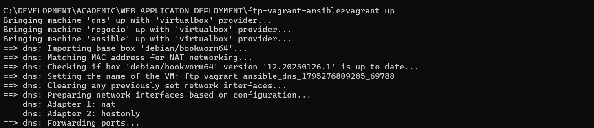
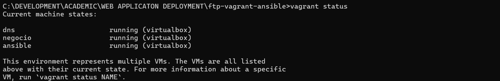
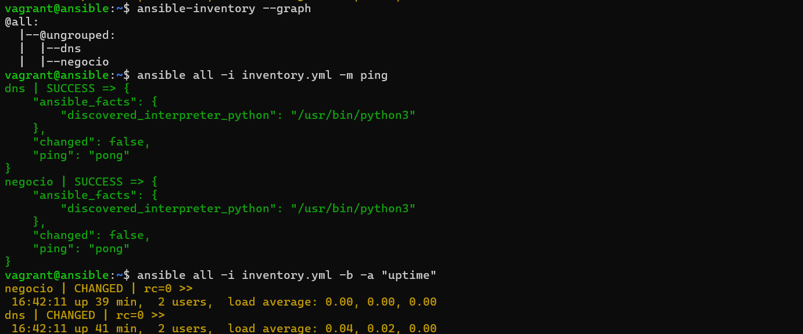
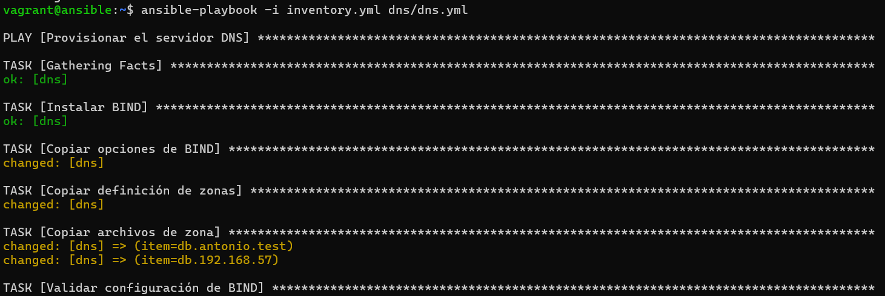
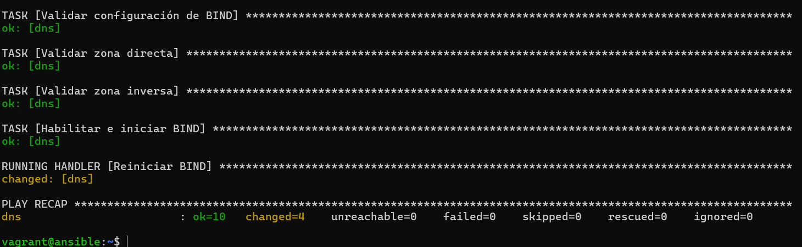
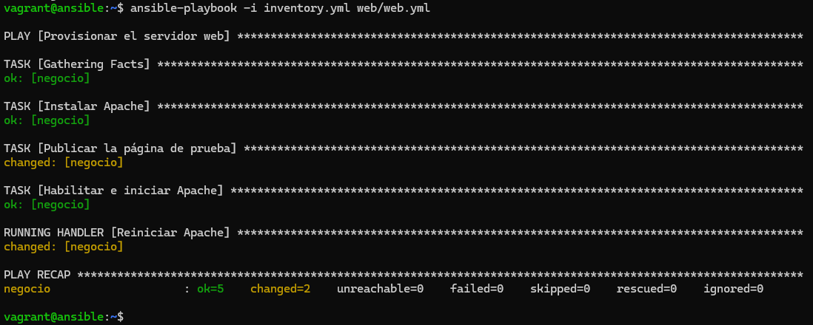
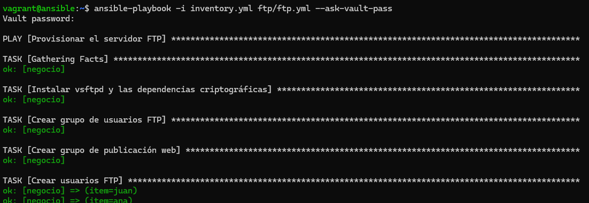
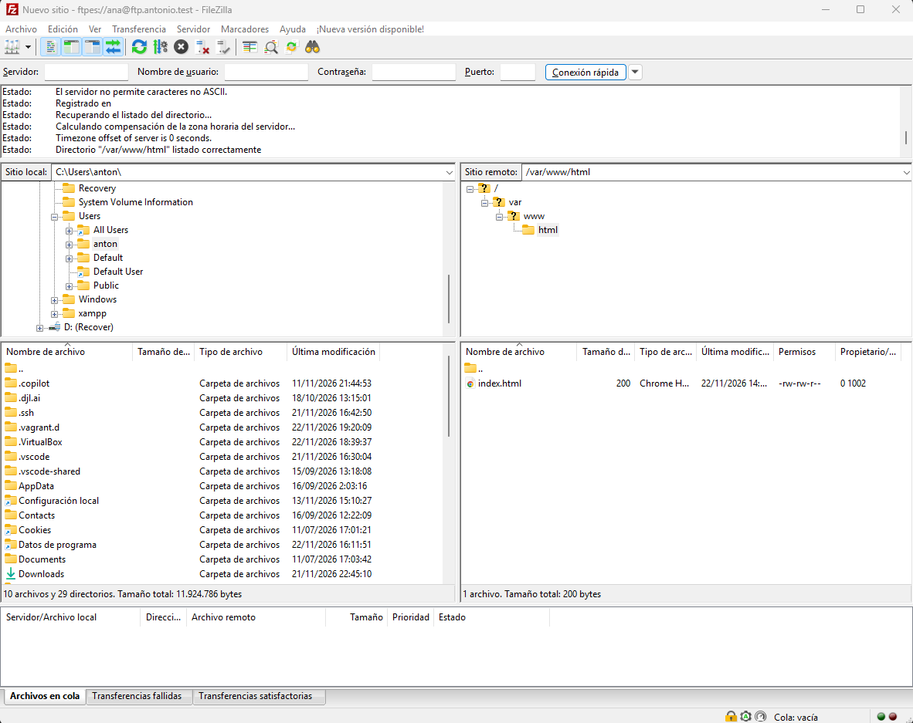
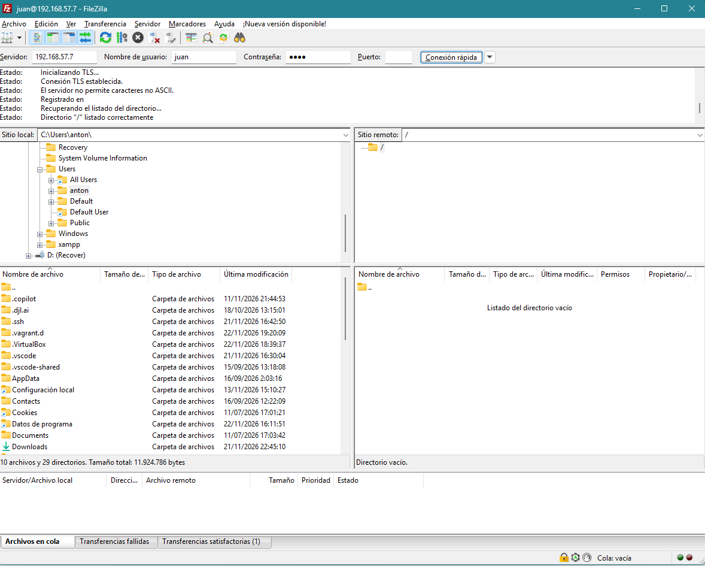

# FTP con Vagrant y Ansible

**Autor:** Antonio Jiménez Balbuena
**Repositorio:** https://github.com/Antonio2907/ftp-vagrant-ansible

## Objetivo

Desplegar de forma automatizada un entorno con tres máquinas virtuales:
un servidor DNS, un servidor web (Apache) y un servidor FTP seguro (vsftpd
con TLS), todo provisionado con Ansible desde un nodo de control.
El dominio de la práctica es `antonio.test`.

## Herramientas utilizadas

- **GitHub**: repositorio, issues y GitHub Projects para gestionar las tareas.
- **Vagrant**: creación de las máquinas virtuales (`debian/bookworm64`).
- **VirtualBox**: proveedor de virtualización de Vagrant.
- **Ansible**: provisionamiento de DNS, web y FTP.
- **BIND9**: servidor DNS.
- **Apache2**: servidor web.
- **vsftpd**: servidor FTP con TLS (FTPES).

## Instrucciones iniciales

1. Clonar el repositorio:
   `git clone https://github.com/Antonio2907/ftp-vagrant-ansible.git`
2. Entrar en la carpeta y levantar las máquinas: `vagrant up`
3. Comprobar que están creadas: `vagrant status`
4. Conectarse al nodo de control: `vagrant ssh ansible`
5. Ejecutar los playbooks desde el nodo de control (ver cada apartado del proyecto).

## Licencia

Este proyecto se distribuye bajo licencia MIT. Ver el archivo [LICENSE](LICENSE).

## 1. Crear las maquinas virtuales

Creamos los ficheros:

- `script\ansible.sh`
- `requirements.yml`
- `Vagrantfile`

Despues arrancamos la maquina virtual con `vagrant up` y revisamos su estado con `vagrant status`

## 2. Definir opciones SSH

Consultamos la configuracion ssh de las maquinas con `vagrant ssh-config` y despues creamos el fichero:

- `ansible.cfg`

### 2.1 Inventario

Creamos en el archivo `inventory.yml` y comprobamos que ansible puede leer el inventario y mostrar sus maquinas.

## 3. Configurar el servidor DNS con BIND mediante un playbook.

Creamos el directorio `dns/` y dentro de el `dns.yml` y otro directorio `file/` en el que añadiremos los archivos de configuracion y zonas.

Despues de eso ejecutaremos el playbook y comprobaremos las zonas.

## 4. Provisionar www.antonio.test

Creamos un directorio `web\` y dentro el playbook `web.yml`, despues creamos la pagina de prueba `index.html`.

Con esos dos archivos creados procedemos a ejecutar el playbook.

## 5. Provisionar ftp.antonio.test

Creamos los archivos de configuracion, entramos dentro de la maquina y descargamos `whois` para sacar los hashes de los usuarios.

Creamos el archivo cifrado con las contraseñas `vault.yml` y un fichero ejemplo del `vault.yml`

Creamos el playbook `ftp.yml` y lo ejecutamos usando las contraseñas guardadas.

Crearemos un fichero `vault_pass.txt` con la contraseña `daw` dentro para que el script de provisión la copie dentro de la máquina virtual `ansible` y poder leer el vault sin tener que escribir la contraseña en la terminal.

## 6. Probar el servicio con un cliente gráfico como FileZilla o WinSCP.

Instalamos FileZilla y nos conectamos con el servidor mediante la ip, el puerto 21 y el usuario de ana. Comprobamos que se ve la estructura de ficheros y que podemos añadir archivos.

Despues volvemos a crear otra conexion pero esta vez con el usuario de juan y comprobamos que no tiene acceso a los ficheros ni puede hacer cambios

